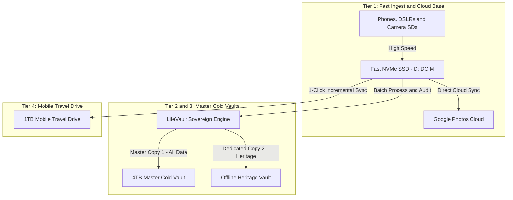

# 🏛️ LifeVault: Sovereign Personal Data Lakehouse & Archivist
> **An enterprise-grade, zero-loss multi-drive storage architecture, hybrid relational/columnar telemetry lakehouse, and sovereign ground-truth substrate for Personal AI & Digital Twins.**

[](https://github.com/kartabyakrishna/LifeVault/actions/workflows/ci.yml)
[](LICENSE)
[](https://python.org)
[]()
[]()

---

## 🌌 The Paradigm

Over a 20- to 30-year modern lifespan, every human accumulates hundreds of thousands of irreplaceable digital artifacts: smartphone camera rolls, mirrorless camera RAW captures, call recordings, voice notes, childhood family albums, scanned vintage documents, chat histories, and millions of wearable biometric sensor readings.

Today, this data is **catastrophically fragmented**: scattered across failing external hard drives, old laptops, and proprietary cloud silos (Google Photos, iCloud, WhatsApp). Most people live under constant threat of silent bit rot, accidental deletion, drive failure, or cloud vendor lock-in.

**LifeVault** solves this with an immutable chain-of-custody archivist and hybrid personal lakehouse:
1. **Immutable Chain of Custody**: Master media blobs are strictly read-only after ingestion. Zero in-place byte mutations—metadata overrides live in SQLite and Parquet sidecars to preserve cryptographic SHA-256 parity across drives.
2. **Hybrid Storage Engine**: SQLite (WAL mode) manages discrete events, relationships, and provenance; Apache Parquet (via Polars/PyArrow) stores high-frequency wearable sensor streams (heart rate, GPS trackpoints, HRV).
3. **Probabilistic Cross-Source Linking**: Recompressed derivatives (e.g., high-res camera originals vs. WhatsApp downsampled images) are linked via 64-bit Perceptual Hashing (`pHash`/`dHash`) and temporal proximity inside an `item_links` graph.
4. **4-Tier Sovereign Redundancy**: Enforces strict physical separation across fast NVMe staging, permanent locked cold vaults, and portable travel storage.

---

## 🏗️ 4-Tier Multi-Drive Storage Topology



---

## 💽 Hardware Tier Roles

| Tier | Drive Medium | Designation | Responsibility & Retention Policy |
| :--- | :--- | :--- | :--- |
| **Tier 1** | **Internal Gen4 NVMe (`D:\DCIM`)** | Fast Ingestion Buffer | Primary staging ground for phone and camera dumps. Google Photos syncs directly from here. |
| **Tier 2** | **4TB+ External HDD (`F:\`)** | Master Cold Vault | Master Copy 1 holding 100% of all data in existence. **Remains locked at home.** |
| **Tier 3** | **1TB+ External HDD (`E:\`)** | Heritage Vault | Dedicated Master Copy 2 of priceless childhood media (pre-2020), vintage family scans, and call recordings. |
| **Tier 4** | **1TB Mobile Drive (`G:\`)** | Travel Working Mirror | Clean single-volume working backup drive for travel. Incremental sync via 1-click script. |

---

## 🚀 Quickstart & Installation

### Installation
Clone the repository and install in editable mode:
```bash
git clone https://github.com/kartabyakrishna/LifeVault.git
cd LifeVault
pip install -e .
```

### 1. Ingest Omnichannel Data
Ingest heterogeneous sources into the lakehouse with zero byte mutation:
```bash
# Ingest camera RAWs & smartphone DCIM
lifevault ingest dcim "D:/DCIM/Camera" --db manifest.db

# Ingest Google Takeout (matches sidecar JSONs non-destructively)
lifevault ingest takeout "D:/Takeout" --db manifest.db

# Ingest Samsung Health data dumps (CSVs + GZIP live_data JSONs to Parquet)
lifevault ingest shealth "D:/SamsungHealth" --db manifest.db --telemetry-root _Telemetry

# Ingest CubeCall & voice recordings (extracts caller entity + timestamp)
lifevault ingest calls "D:/VoiceRecordings" --db manifest.db

# Ingest WhatsApp chats and media
lifevault ingest whatsapp "D:/WhatsAppExport" --db manifest.db
```

### 2. Probabilistic Near-Duplicate Linking (pHash)
Link recompressed social media images against camera originals using Hamming distance:
```bash
lifevault link --db manifest.db --max-dist 8
```

### 3. Wearable GPS Interpolation
Intersects untagged photo timestamps with Galaxy Watch GPS trackpoints to assign geographic coordinates:
```bash
lifevault interpolate --db manifest.db --telemetry-root _Telemetry --max-gap 600
```

### 4. Bit-for-Bit Deduplication & Quarantine
Isolate exact SHA-256 duplicate copies into `_Duplicates_Quarantine/` without deleting a single byte:
```bash
lifevault dedup --db manifest.db
```

### 5. Incremental Travel Drive Sync
Sync newly staged photos from fast internal storage to your mobile backup:
```bash
lifevault sync --source "D:/DCIM" --dest "G:/DCIM" --audit-db "G:/DCIM/sync_audit.db"
```

### 6. Forensic Cross-Drive Audit
Verify that 100% of files from your source drive exist on your vault drive:
```bash
lifevault audit --source "E:/SourceDrive" --target "F:/Vault"
```

### 7. Atomic Rollback
Safely restore files back to their original source locations using the SQLite transaction log:
```bash
lifevault rollback --db manifest.db
```

---

## 🛡️ Core Safety Invariants

- **Absolute Zero Deletion**: Duplicates are safely segregated into mirror quarantine directories. No file is ever deleted automatically.
- **Zero Byte-Mutation**: Original files are never modified in-place. All metadata and tags reside in SQLite or Parquet sidecars.
- **ACID Manifest Ledger**: SQLite WAL mode guarantees transactional consistency for file status, hashes, and relational links.
- **Fault-Tolerant Cross-Volume Moves**: Atomic copy-verify-swap prevents partial copies or data loss during unexpected drive disconnects.

---

## 📄 License
Released under the [MIT License](LICENSE). Built for humans and digital twins everywhere.
